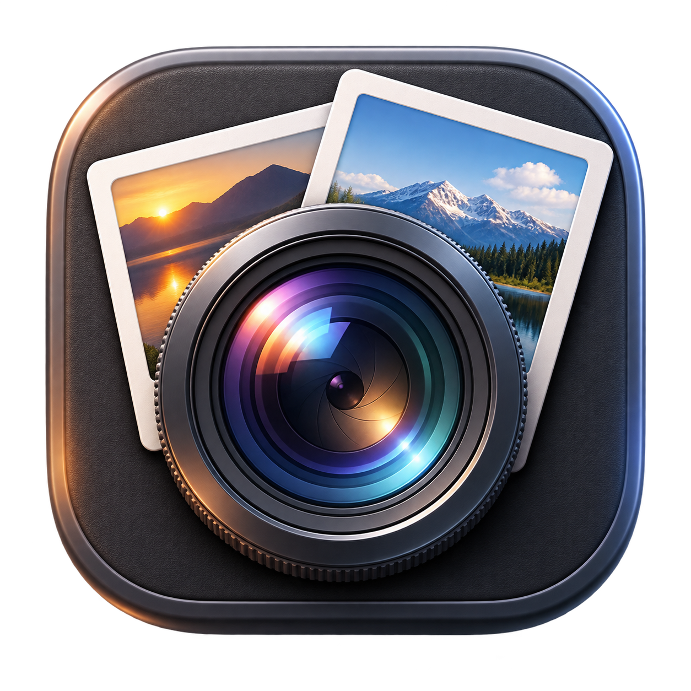
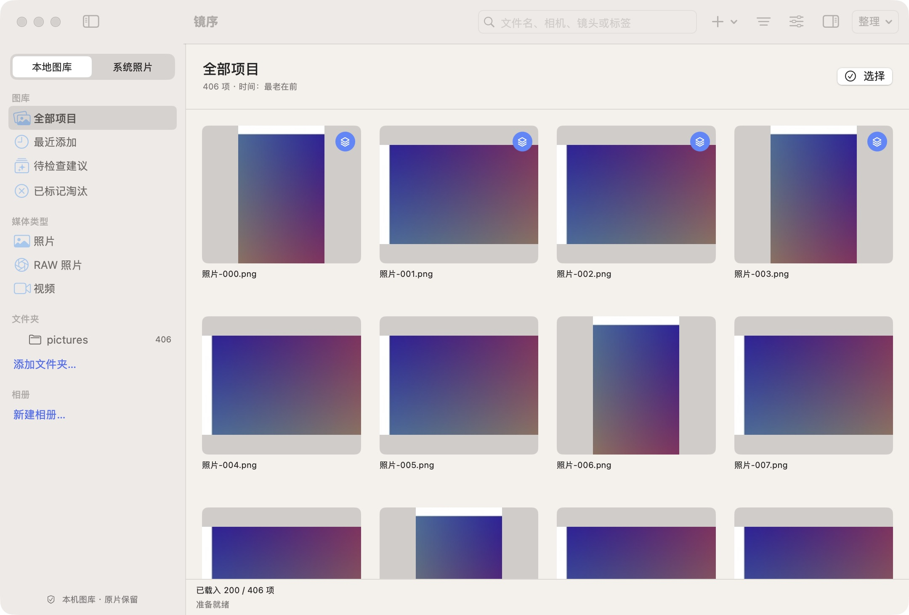
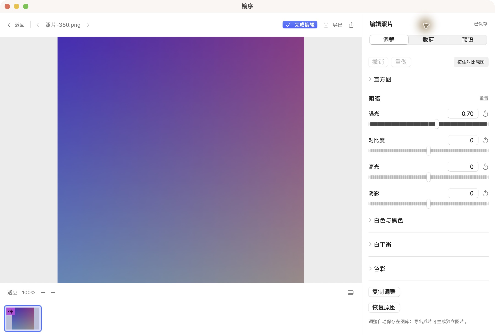

# 镜序 · JingXu

**把照片从相机卡，整理到满意的成片。**

镜序是一款面向摄影爱好者的原生 Mac 照片整理工具。直接打开已有照片文件夹，浏览 RAW 与 JPEG，挑选、评分、调色，再导出或整理到合适的目录。

本地处理 · 无需镜序账户 · 非破坏式调色

**[下载 v0.9.0 测试版（Apple Silicon）](https://github.com/beihai0xff/JingXu/releases/download/v0.9.0/JingXu-0.9.0-test.34-macOS-arm64.dmg)** · [所有版本与更新说明](https://github.com/beihai0xff/JingXu/releases)

[下载安装](#下载安装) · [快速上手](#快速上手) · [界面预览](#界面预览) · [常见问题](#常见问题) · [使用帮助](#使用帮助)

## 下载安装

需要 **macOS 14 Sonoma 或更新版本、Apple Silicon（M 系列芯片）Mac**。当前安装包不支持 Intel Mac。

1. [下载 DMG 安装包](https://github.com/beihai0xff/JingXu/releases/download/v0.9.0/JingXu-0.9.0-test.34-macOS-arm64.dmg)。
2. 打开 DMG，将「镜序.app」拖入「应用程序」。
3. 从「应用程序」打开镜序，添加一个照片文件夹即可开始。

> 当前提供的是未经 Apple 公证的测试版，macOS 可能阻止打开。安装前请阅读 [v0.9.0 发布说明](https://github.com/beihai0xff/JingXu/releases/tag/v0.9.0)；若系统拒绝启动，不要关闭系统安全保护。

<details>
<summary>使用 Homebrew 安装</summary>

已安装 Homebrew 的用户，可在终端运行：

```sh
brew tap beihai0xff/jingxu https://github.com/beihai0xff/JingXu.git
brew install --cask beihai0xff/jingxu/jingxu
```

安装后，从「应用程序」打开镜序。Homebrew 安装的也是当前测试版。

</details>

<details>
<summary>更新已有安装</summary>

更新前，先完成或安全取消后台任务，处理未完成的归档／移动恢复提示，备份图库并退出镜序。

- **DMG 安装**：下载新版，将「镜序.app」拖入「应用程序」替换旧版，保留原有图库与应用数据。
- **Homebrew 安装**：在终端运行：

```sh
brew update
brew upgrade --cask beihai0xff/jingxu/jingxu
```

镜序目前没有应用内自动更新。旧版图库的支持范围和恢复方式见 [旧图库升级说明](Documentation/LegacyCatalogUpgrade.md)；不要通过删除图库来绕过打开失败。手动安装后希望改用 Homebrew 管理，见 [安装与接管说明](Documentation/Homebrew.md)。

</details>

## 用镜序做什么

| 你想做的事 | 镜序如何帮助你 |
| --- | --- |
| 管理硬盘里已有的照片 | 添加文件夹，在原位置建立索引，无需再复制一份；按目录浏览、按拍摄时间排序，用评分与关键词查找。 |
| 从相机卡导入 | 复制前核对清单，复制后校验文件，跳过重复内容，保留卡里的原文件。 |
| 从一批照片里挑出喜欢的 | 大图查看、100% 检查细节、双图比较，用星级、淘汰标记和相册整理。 |
| 调整照片并输出成片 | 调整明暗、白平衡与色彩，裁剪或套用预设，导出 JPEG、PNG 或 16 位 TIFF。 |
| 整理磁盘目录 | 按拍摄日期归档，或将选中照片移到同一磁盘的指定目录；评分、标签和相册关系随之保留。 |

日常浏览、评分和调色不会改写原照片。**归档、移动和清理会操作真实文件**，执行前需要核对清单；图库备份不能代替原片备份。

## 快速上手

### 1. 添加照片

照片已在电脑或外接硬盘上：点击「添加文件夹…」，选择照片所在目录并授权访问。照片仍留在原位置。

照片还在相机卡上：选择「从相机卡导入」，指定目标文件夹，核对导入清单后开始复制。

### 2. 挑选喜欢的照片

双击照片查看大图，用左右方向键切换。给喜欢的照片评分，再按星级筛选；也可以创建相册，将一次旅行或一次拍摄的照片放在一起。

| 常用按键 | 操作 |
| --- | --- |
| `0`–`5` | 设置星级，`0` 为取消评分 |
| `Shift` + `0`–`5` | 评分后前往下一张，适合连续选片 |
| `Delete` / `⌫` | 标记淘汰；单张选片时前往下一张，**不会直接删除文件** |
| `U` | 取消淘汰标记 |
| `←` / `→` | 在大图中查看上一张／下一张 |

### 3. 调色与裁剪

在单图中打开调色工具，调整曝光、阴影、白平衡或饱和度；通过原图对比检查效果。需要改变取景时使用裁剪，也可以保存常用调整为预设。

本地照片的调整自动保存在镜序图库中，原文件保持不变。要在其他应用中使用调整后的照片，需要导出成片。

### 4. 导出与分享

选择要输出的照片，点击「导出」，选择格式与目标文件夹，核对清单后执行。日常分享可选 JPEG，需要无损格式可选 PNG 或 16 位 TIFF。已有同名文件会跳过，不会被覆盖。

也可以通过系统分享菜单，分享原片或调色后的 JPEG，发送目标由你选择。

需要清理时，先检查「已标记淘汰」中的照片，再使用清理功能，将确认不要的本地文件移到系统废纸篓。

## 界面预览

以下展示 **v0.9.0 的实际界面**，截图中的图片为合成演示素材。新界面已包含在上方下载包中，改进内容见 [v0.9.0 发布说明](https://github.com/beihai0xff/JingXu/releases/tag/v0.9.0)。

**浏览与选片**：左侧选择文件夹和相册，中间浏览照片；搜索与筛选集中在顶部。



**编辑照片**：大图旁集中放置调整、裁剪和预设，随时对比原图，再导出成片。



## 常见问题

<details>
<summary>照片会上传吗？需要注册吗？</summary>

镜序无需镜序账户，没有自建服务端或遥测，默认在本机索引、分析和渲染照片。

两项可选功能涉及外部服务：连接系统照片后，iCloud 同步由 macOS「照片」管理；主动启用 Codex 调色连接后，所选照片的缩小预览、文件名、调整参数及明确请求的操作清单可能进入 AI 助手上下文。Codex 连接默认关闭，详见 [连接说明](Documentation/CodexColorControl.md)。

</details>

<details>
<summary>支持哪些格式？能替代专业修图软件吗？</summary>

可浏览 macOS 能解码的 RAW、JPEG、HEIC、PNG、TIFF，并索引和预览本地视频。RAW 支持取决于系统对相机型号的兼容情况。

镜序适合照片整理、选片与基础调色；当前不提供局部修图、人脸识别、地图或视频剪辑。可导入部分 Lightroom XMP 基础参数预设，不支持曲线、HSL、蒙版等完整效果，也不保证与 Lightroom 出片一致。

</details>

<details>
<summary>淘汰、移出相册和删除照片有什么区别？</summary>

- **标记淘汰**：只做标记，文件还在原处。
- **移出相册、删除相册或移除来源**：移除镜序中的组织关系，不删除原照片。
- **清理本地照片**：核对清单并确认后，将文件移到 macOS 废纸篓。
- **删除系统照片**：通过系统照片图库删除，由「最近删除」提供恢复，并可能随 iCloud 同步到其他设备。

</details>

<details>
<summary>可以使用系统照片和 iCloud 相册吗？</summary>

可以选择连接「系统照片」，授权后浏览图库、加入照片、管理普通相册与保存单图调色。这是试用功能，建议先用少量已备份照片体验。

系统照片的调色先保存为本机草稿，只有点击「保存到系统照片」才提交。镜序显示已保存，不代表 iCloud 已同步完成；同步状态由 macOS 管理。镜序不接收 Apple 账户密码。详见 [系统照片使用说明](Documentation/SystemPhotos.md)。

</details>

<details>
<summary>质量分析会自动选出好照片或删除照片吗？</summary>

不会。质量诊断、明暗统计和相似连拍信息只辅助人工挑选，不自动决定哪张最好，也不自动删除照片。新模糊报警目前尚未开放。

</details>

## 使用帮助

- [安全导入](Documentation/SafeImport.md) · [按文件夹浏览](Documentation/FolderBrowsing.md) · [浏览与选片](Documentation/BrowsingAndCulling.md)
- [调色、裁剪、预设与导出](Documentation/ColorEditing.md) · [分享照片](Documentation/PhotoSharing.md)
- [按日期归档](Documentation/DateArchive.md) · [批量移动](Documentation/BatchMove.md)
- [系统照片与 iCloud](Documentation/SystemPhotos.md) · [Codex 辅助调色](Documentation/CodexColorControl.md)
- [安装与更新](Documentation/Homebrew.md) · [旧图库升级](Documentation/LegacyCatalogUpgrade.md)

遇到问题或有功能建议，可以 [提交反馈](https://github.com/beihai0xff/JingXu/issues)。请附上镜序版本、macOS 版本和复现步骤；截图前注意隐藏私人照片与路径。

---

开发与贡献：[开发指南](AGENTS.md) · [构建与发布](Documentation/ReleasePipeline.md)
